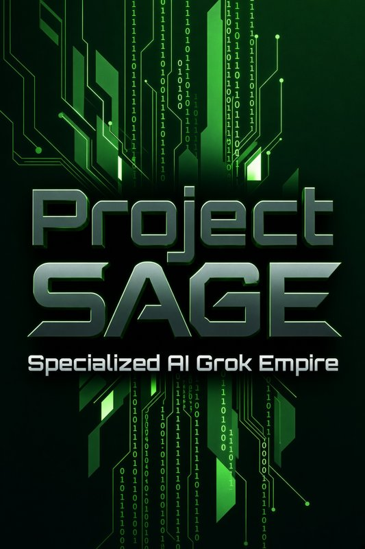

<p align="center"></p>

# Specialized AI Grok Empire (Project SAGE)

 

## Overview
A framework for running a household or small-business **team of Grok Bots** led by one
**Chief of Staff**. It is a doctrine, a set of charter templates, and a CI harness that keep a team
of AI agents useful, quiet, and safe.

### Why it works
1. **One front door.** The owner talks to the Chief of Staff for high-level topics. Specialists own
   lanes that never overlap, so routing is never ambiguous. Deeper work: the CoS points you to the specialist.
2. **Autonomy by reversibility, not trust.** GREEN (read/draft) and YELLOW (bounded internal writes)
   run alone. RED (send, pay, trade, order, publish, delete, permissions, device setpoints) needs owner
   approval *every time*, on the exact payload.
3. **No guessing.** Missing or stale data produces a **gap card**, never a fluent fabrication.
4. **Priority you can measure.** XREP / P1 / P2 / P3 with response targets and on-time grading.
5. **Quiet hours with explicit breakers.** The team stays silent overnight except for true emergencies.
6. **A fixed report cadence.** Morning brief, evening report, weekly and monthly reviews.
7. **Privacy by structure.** Sensitive classes (health, finance, school, network) never enter git;
   CI enforces it.
8. **Decisions are written down.** ADRs and missions record every rule and why.

## Quickstart
```bash
git clone https://github.com/crusader0711/specialized-ai-grok-empire.git
cd specialized-ai-grok-empire
make setup    # install git hooks
make lint test
```
Then follow [docs/HOW-TO.md](docs/HOW-TO.md).

## Architecture
See [docs/architecture.md](docs/architecture.md) for the system boundary and data flow.

### The team
| Bot id | Role |
|---|---|
| `chief-of-staff` | Chief of Staff |
| `weather` | Weather & Hazards |
| `kitchen` | Kitchen Chef |
| `academic-steward` | Academic Advisor / Repo Steward |
| `finance` | Finance |
| `markets` | Markets |
| `home-systems` | Home Systems |
| `health` | Health & Longevity |

Themes are optional: see [docs/THEMING.md](docs/THEMING.md).

## Usage
- [docs/HOW-TO.md](docs/HOW-TO.md): set up your team in Grok Bot, step by step.
- [docs/BOOTSTRAP-CHIEF-OF-STAFF.md](docs/BOOTSTRAP-CHIEF-OF-STAFF.md): hand this to your Chief of Staff so it builds every bot for you, one approval at a time.
- [docs/doctrine/](docs/doctrine/): priority scoring, tiers, autonomy, quiet hours, freshness, routing, cadence.
- [templates/](templates/): charter, mission, gap card, handoff, routine spec, skill.
- [skills/](skills/): agent skill definitions (one `SKILL.md` per capability).
- [src/dashboard/](src/dashboard/): GROK EMPIRE static dashboard (Empire + Fleet pages). Preview with `python3 -m http.server -d src/dashboard`.

## Development
Run `make help` for every verb (`setup`, `lint`, `test`, `build`, `release`, `clean`).
AI agents start at [AGENTS.md](AGENTS.md). Layout and file index: [WIKI.md](WIKI.md).
Contribution rules: [CONTRIBUTING.md](CONTRIBUTING.md). Security: [SECURITY.md](SECURITY.md). Privacy: [PRIVACY.md](PRIVACY.md).

## License
MIT (see [LICENSE](LICENSE)). Third-party credits: [ATTRIBUTION.md](ATTRIBUTION.md).
